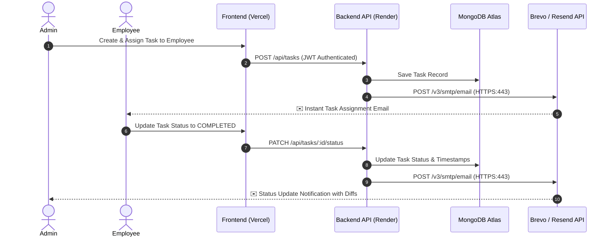

# 🚀 TaskFlow — Enterprise Role-Based Task Management System

<div align="center">

[](https://task-management-system-two-xi.vercel.app)
[](https://task-management-system-uu4p.onrender.com/api/health)

**A full-stack, enterprise-grade task orchestration platform engineered with the MERN stack (MongoDB Atlas, Express.js, React, Node.js), featuring strict Role-Based Access Control (RBAC) and automated transactional email dispatch via Brevo & Resend Cloud APIs.**

[Explore Live Demo](https://task-management-system-two-xi.vercel.app) • [Report Bug](https://github.com/Mounika462006/Task_Management_System/issues) • [Request Feature](https://github.com/Mounika462006/Task_Management_System/issues)

</div>

---

## 🌟 Live Deployments

| Component | Platform | URL |
| :--- | :--- | :--- |
| **Frontend Web Client** | **Vercel** | [https://task-management-system-two-xi.vercel.app](https://task-management-system-two-xi.vercel.app) |
| **Backend REST API** | **Render Cloud** | [https://task-management-system-uu4p.onrender.com](https://task-management-system-uu4p.onrender.com) |
| **Database** | **MongoDB Atlas** | Cloud Multi-Region Cluster (IPv4/v6) |

---

## ✨ Key Features

### 🔐 1. Unified Authentication & Role-Based Access Control (RBAC)
- **Single Sign-On Entry**: Smart portal routing users dynamically based on role (`ADMIN` ➔ `/admin/dashboard`, `EMPLOYEE` ➔ `/employee/dashboard`).
- **Security Protocols**: Salted bcrypt hashing, JWT token verification, and route-level authorization guards on both client and server.

### 📋 2. Comprehensive Task Lifecycle Management
- **Task Creation & Assignment**: Administrators can create tasks with priority levels (`Low`, `Medium`, `High`, `Urgent`), descriptions, and deadlines, assigning them to designated team members.
- **Real-Time Status Transitions**: Employees can transition task states smoothly (`NOT_STARTED` ➔ `IN_PROGRESS` ➔ `COMPLETED`).
- **Granular Permissions**: Employees only have visibility into tasks explicitly assigned to them; Administrators maintain 360-degree organizational visibility.

### 📧 3. Automated Dual-Way Email Dispatch (Cloud Optimized)
- **Engineered for Free-Tier Cloud Resilience**: Utilizes **Brevo (Sendinblue) & Resend REST APIs** over standard HTTPS Port 443 — bypassing outbound SMTP port-blocking (ports 465/587) enforced by cloud providers.
- **Admin ➔ Employee Notification**: Instant, beautifully branded HTML email dispatched to the assigned employee upon task creation.
- **Employee ➔ Admin Notification**: Whenever an employee updates task progress, the administrator receives an automated audit email containing status diffs, timestamps, and direct deep-links.

### 📊 4. Executive Analytics & Metric Dashboards
- **KPI Metrics**: Real-time counters for Total Tasks, In Progress, Completed, Overdue, and Employee performance.
- **Modern Apple-Inspired UI**: Clean typography, 8px layout grid, accessible color-coded badges, and responsive sidebar navigation powered by Lucide icons.

---

## 🛠️ Technology Stack

```
Frontend:   React 18 • Vite • React Router v6 • Axios • Lucide React • Vanilla CSS
Backend:    Node.js (v20+) • Express.js • Mongoose ODM • JWT • Zod Validation • Helmet • CORS
Email API:  Brevo HTTP API (Port 443) • Resend API • Nodemailer (Local Fallback)
Database:   MongoDB Atlas (Cloud Cluster)
Deployment: Vercel (Frontend SPA) • Render (Backend Web Service)
```

---

## 🏗️ Architecture & Communication Flow



---

## 📁 Repository Structure

```
Task_Management_System/
├── client/                     # Frontend Single Page Application (React + Vite)
│   ├── public/                 # Static assets & branding logos
│   ├── src/
│   │   ├── components/         # Reusable modals, tables, and navbar components
│   │   ├── layouts/            # AdminLayout & EmployeeLayout wrappers
│   │   ├── pages/              # Auth, Admin Dashboard, and Employee Task views
│   │   ├── services/           # Axios API service instances with interceptors
│   │   └── routes/             # ProtectedRoute guards and RBAC routes
│   ├── vercel.json             # Vercel SPA routing rewrites
│   └── vite.config.js          # Vite build config with dev proxy
│
├── server/                     # Backend Express.js REST API
│   ├── src/
│   │   ├── config/             # Database connection & Brevo/Resend mail drivers
│   │   ├── controllers/        # Auth, Task, Employee & Dashboard controllers
│   │   ├── middleware/         # Auth verification, role checks, and error handlers
│   │   ├── models/             # Mongoose schemas (User, Task)
│   │   ├── routes/             # REST API endpoints
│   │   └── services/           # Business logic & transactional email templates
│   └── package.json
│
├── vercel.json                 # Root deployment config with rewrite fallbacks
└── package.json                # Monorepo workspace scripts
```

---

## ⚡ API Endpoints Summary

### Authentication
- `POST /api/auth/register` — Register a new account
- `POST /api/auth/login` — Authenticate and receive JWT token + session cookie
- `POST /api/auth/logout` — Invalidate user session
- `GET  /api/auth/me` — Retrieve current authenticated profile

### Task Management
- `GET    /api/tasks` — List tasks (Admin: all, Employee: self only)
- `POST   /api/tasks` — Create task & trigger employee notification (`ADMIN`)
- `GET    /api/tasks/:id` — Retrieve task details
- `PATCH  /api/tasks/:id` — Edit task details (`ADMIN`)
- `PATCH  /api/tasks/:id/status` — Update task status & notify admin (`EMPLOYEE`)
- `DELETE /api/tasks/:id` — Delete task (`ADMIN`)

### Employee Management (`ADMIN` only)
- `GET    /api/employees` — List all registered staff members
- `POST   /api/employees` — Add team member
- `PUT    /api/employees/:id` — Update member profile
- `DELETE /api/employees/:id` — Terminate team member

### System Diagnostics
- `GET /api/health` — API server heartbeat
- `GET /api/health/email` — Email gateway status check (`?to=recipient@gmail.com`)

---

## 💻 Local Development Setup

### 1. Clone the repository
```bash
git clone https://github.com/Mounika462006/Task_Management_System.git
cd Task_Management_System
```

### 2. Configure Environment Variables
Create a `.env` file in the `server/` directory:
```env
PORT=5000
NODE_ENV=development
MONGODB_URI=your_mongodb_atlas_connection_string
JWT_SECRET=your_super_secret_jwt_key
JWT_EXPIRES_IN=7d
CLIENT_URL=http://localhost:5173

# Email API Settings (Brevo or Resend)
BREVO_API_KEY=your_brevo_api_key
BREVO_SENDER=your_verified_email@gmail.com

# Admin defaults
ADMIN_EMAIL=admin.taskflow@gmail.com
```

### 3. Install Dependencies & Launch
From the repository root:
```bash
# Start backend server (Port 5000)
npm run server

# In a separate terminal, start frontend client (Port 5173)
npm run client
```

Visit **`http://localhost:5173`** in your browser.

---

## 🛡️ Security Best Practices
- **Strict Preflight CORS**: Configured to restrict origins to verified client domains with credential headers.
- **Input Sanitization**: Request bodies sanitized and strictly validated using Zod schemas.
- **Secure Password Storage**: Passwords salted and hashed with `bcryptjs`.
- **Helmet HTTP Headers**: Standard CSP and OWASP security headers enabled on all responses.

---

## 👩‍💻 Author

**Mounika N**  
- GitHub: [@Mounika462006](https://github.com/Mounika462006)  
- Project: [Task_Management_System](https://github.com/Mounika462006/Task_Management_System)

